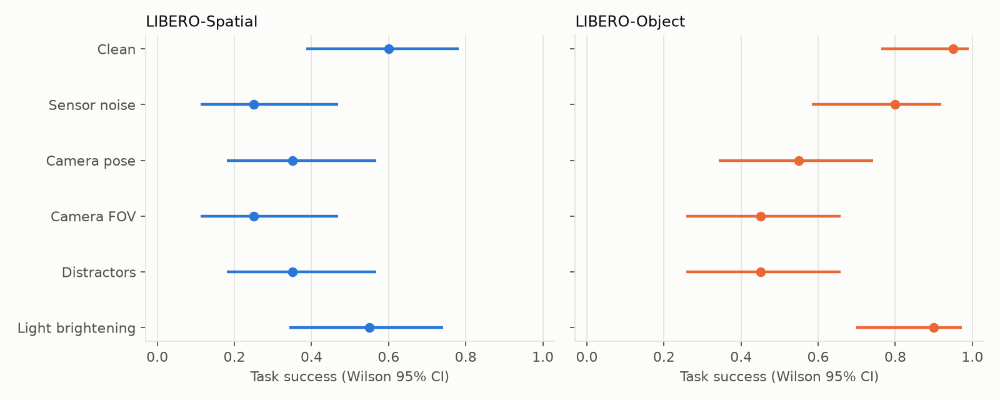
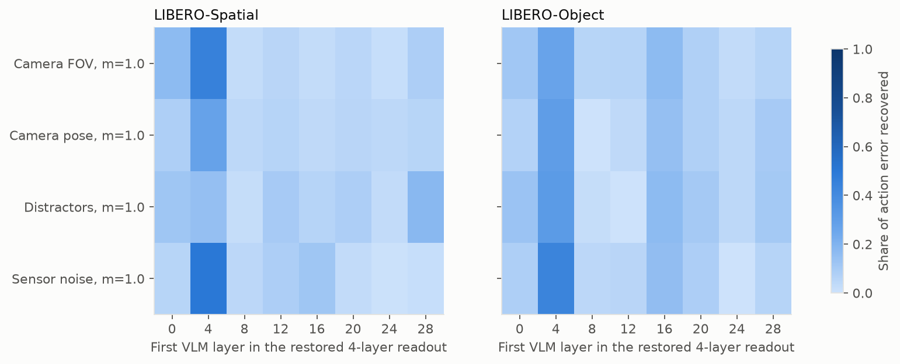

# faultline_vla

**Where inside a Vision-Language-Action model does a visual failure happen?**

Robot policies built on vision-language models often fail when the scene looks different: a moved camera, new lighting or extra objects on the table. Benchmarks such as LIBERO-Plus measure how much success drops, but not *where* in the network the failure arises. This project traces visual failures inside [SmolVLA](https://arxiv.org/abs/2506.01844), a 605M-parameter VLA, on the [LIBERO](https://github.com/Lifelong-Robot-Learning/LIBERO) manipulation benchmark. The question is whether they arise in the vision encoder, the language backbone or the action expert.

Everything here runs on a laptop CPU (Apple M1 Pro, inside arm64 Linux Docker). No GPU was used.

## Findings

1. **Visual changes, such as a moved camera or extra objects, barely change the model's next move, yet they make it fail whole tasks.** Shown the same moment with and without a perturbation, SmolVLA predicts almost the same next movement of the arm. SmolVLA samples its actions with some randomness, so even rerunning it on the identical image changes the movement a little. For none of the 9 perturbation types, on either suite, is the change detectably larger than that. Only sensor noise on LIBERO-Spatial comes close, with a mean change slightly above the rerun variation but an interval that includes it. Yet when the robot carries out whole tasks with the perturbation present, it fails much more often (below). A likely reason is that a slight error repeated at every step builds up over the course of a task.

2. **Distractor objects break the policy on both suites. Camera changes probably break it on LIBERO-Object.** The figure shows a paired closed-loop screen of 240 episodes:

   

   | Perturbation | LIBERO-Spatial success | LIBERO-Object success |
   |---|---|---|
   | None (clean) | 12/20 | 19/20 |
   | Distractor objects | 7/20 (drop) | 9/20 (drop) |
   | Camera field of view | 5/20 | 9/20 (drop) |
   | Camera pose | 7/20 | 11/20 (drop) |
   | Sensor noise | 5/20 (drop) | 16/20 |
   | Brighter lighting (control) | 11/20 | 18/20 |

   A drop is marked when the 95% bootstrap interval of the paired drop excludes 0, a rule fixed before the run. Only distractors meet it on both suites, so only that failure counts as confirmed. Camera pose and FOV (Object only) and sensor noise (Spatial only) are suggestive. LIBERO-Spatial's clean baseline is itself low (12/20), so its intervals are wide.

3. **The failure has no single location.** The action expert reads a cached copy of every VLM layer. Swapping clean values into any block of up to 16 of the 32 layers removes at most 41–68% of the action error, so no window passes the pre-set 80% bar. The visual change is formed in the frozen vision encoder and carried almost unchanged through all 32 VLM layers. Layers 4–7 carry the largest single share. A partial check at weaker strength (5 LIBERO-Object tasks) gives the same picture.

   

4. **The perturbations re-encode the scene rather than erase it.** On LIBERO-Object, a linear probe can still read where the target object is from perturbed features, as well as from clean ones, once it is retrained on them. A probe trained on clean features fails on perturbed ones. So the information survives, but in a form that a readout trained only on clean images doesn't follow. On LIBERO-Spatial the probes are too weak to tell. This analysis was added after the planned one turned out uninformative (see the Stage 3 report).

5. **A cheap targeted fix would have to sit at or before the connector, not in the VLM.** The connector maps the vision encoder's output into the VLM, and it is the only way the image enters the model. Restoring its clean output therefore reproduces the clean action by construction. The check (exact in all 320 cases) confirms the patching is wired correctly rather than being a finding in itself. What it shows is that a fix at that point isn't capped the way any block of VLM layers is (finding 3).

These results come from one checkpoint, one strength per perturbation and 20 episodes per condition. Each report lists its limits in a "what this shows / what it doesn't" section.

## Stages

| Stage | Question | Outcome | Report |
|---|---|---|---|
| 0 | Can SmolVLA and LIBERO run usefully on a CPU? | Yes. About 2 s per forward pass in `float32`, and closed-loop success matches published figures. | [stage0.md](reports/stage0.md) |
| 1 | Can we render the same simulator state clean and perturbed? | Yes. 9 axes with exact pairing, and image change rises steadily with strength on all 18 axis-suite pairs. | [stage1.md](reports/stage1.md) |
| 2 | Which perturbations change actions, and which break tasks? | On a single frame, no perturbation changes the predicted movement detectably more than rerunning the model does. On whole tasks, distractors cause failures on both suites. Camera pose and FOV (Object) and sensor noise (Spatial) are suggestive. | [stage2.md](reports/stage2.md) |
| 3 | Where inside the network do those failures arise? | Diffuse on all 8 cases. The change is set in the vision encoder and re-encodes, rather than erases, the target's position. Layers 4–7 matter most. | [stage3.md](reports/stage3.md) |
| 4 | Can a small adapter at the diagnosed site fix it? | Skipped. Stage 3 found no localized site to target. | |
| 5 | Does the fix raise task success? | Skipped, since there is no fix to test. The closed-loop screen in Stage 2 already measures the failures. | |

The project ends at Stage 3. Stages 6 and 7 (a π0.5 comparison and fine-tuning baselines) need a GPU and were not run.

## How it works

- **Paired rendering.** Each perturbation edits the MuJoCo scene (lights, textures, camera, extra objects) or the image (sensor noise), then restores it exactly. Distractor objects are always in the model, parked out of view when unused, so the simulator state is identical between clean and perturbed renders. Only the main (agentview) camera is perturbed. The wrist camera, robot state and instruction are unchanged.
- **Open-loop sensitivity.** SmolVLA predicts an action chunk from the clean and the perturbed image with identical flow-matching noise. The change is compared with how much the action moves when only the noise seed changes.
- **Closed-loop screen.** Paired episodes share the initial state and noise seed. The perturbation is drawn once per episode and held fixed, and the policy replans every 10 steps.
- **Readout patching.** SmolVLA's VLM runs once and caches each layer's keys and values, which the action expert reads at every layer. Mixing clean and perturbed caches layer by layer shows which readouts carry the error, without touching the VLM's own computation. This follows path-patching practice from interpretability research.
- **Probes.** Ridge regressions read the target object's position from features at each depth. Trained on clean and tested on perturbed features (transfer) or retrained on perturbed ones (refit), they separate information that is lost from information that has only moved.
- **Drift.** Clean-vs-perturbed distance of image-token features at each depth, scaled by the distance between two different states of the same task.

Statistics: Wilson intervals for success rates, task-level bootstrap intervals for everything else, separate logged seeds for environment, perturbation and policy noise, and pass/fail rules written down before each run.

## Reproducing

LIBERO's LeRobot integration installs only on Linux, so everything runs in Docker. On macOS, give Docker at least 10 CPUs and about 23 GB of memory for the default worker counts.

```bash
docker build -t faultline-vla docker/
docker volume create faultline-cache   # Hugging Face and LIBERO assets
docker run --rm -it \
  -v faultline-cache:/cache -v "$PWD":/workspace \
  -e PYTHONPATH=/workspace/src \
  faultline-vla bash
```

Inside the container, run the stages in order. Every script takes `--device {cpu,cuda}` (default `cpu`), prints a time estimate, and resumes from its saved shards if restarted. Outputs are tagged with a hash of their config.

```bash
bash scripts/stage0_run.sh                               # benchmark + LeRobot evaluation
python scripts/stage1_image_change.py                    # paired renders and image change
python scripts/stage2_collect_rollouts.py                # clean rollouts for policy-visited states
python scripts/stage2_build_dataset.py                   # prints the dataset hash
python scripts/stage2_action_sensitivity.py --dataset data/stage2/<hash>      # ~1.6 h
python scripts/stage2b_closed_loop_screen.py             # 240 episodes, ~4 h
python scripts/stage3_localize.py --dataset data/stage2/<hash> \
  --conditions sensor_noise/1.0 camera_pose/1.0 camera_fov/1.0 distractors/1.0   # ~5 h
python scripts/stage3_connector_check.py --dataset data/stage2/<hash> \
  --conditions sensor_noise/1.0 camera_pose/1.0 camera_fov/1.0 distractors/1.0   # ~1.2 h
python scripts/stage3_probes.py --workers 1 --threads 3 \
  --conditions sensor_noise/1.0 camera_pose/1.0 camera_fov/1.0 distractors/1.0   # ~4.5 h
```

The weaker-strength check in the Stage 3 report reuses `stage3_localize.py` with `--conditions sensor_noise/0.6 camera_pose/0.6 camera_fov/0.6 distractors/0.5 --figure-suffix _m06`. It was stopped after 5 of 20 shards (LIBERO-Object tasks 0–3 and 6). The full run takes far longer than the m = 1 run, at over 2 hours per shard.

Times are for the M1 Pro above. Lint runs with `ruff check scripts src tests`. Run the two test files in separate processes, `pytest tests/test_perturb.py` and `pytest tests/test_patching.py`, because loading the policy and rendering with OSMesa in one process can segfault.

## Repository layout

```
docker/            Dockerfile for the CPU environment (LeRobot 0.7.0, OSMesa rendering)
docs/              Notes on the checkpoint: architecture, inputs, outputs
src/faultline_vla/
  envs/            Scene setup, paired rendering and the 9 perturbation axes
  models/          Policy loading for CPU inference, and readout patching
  jobs.py          Crash-safe process runner for long jobs
  viz.py           Shared figure style
scripts/           One script per stage
tests/             Unit tests for perturbations and patching
reports/           One report per stage, with figures and limitations
results/           Figures, summary tables and per-episode records
```

Large intermediate data (rendered datasets, activations) goes in `data/`, which is not tracked.

## Related work

- Shukor et al., *SmolVLA* (2025), [arXiv:2506.01844](https://arxiv.org/abs/2506.01844). The model studied.
- Liu et al., *LIBERO* (2023), [arXiv:2306.03310](https://arxiv.org/abs/2306.03310). The benchmark.
- Fei et al., *LIBERO-Plus* (2025), [arXiv:2510.13626](https://arxiv.org/abs/2510.13626). Measures VLA robustness to perturbations behaviorally.
- Goldowsky-Dill et al., *Localizing model behavior with path patching* (2023), [arXiv:2304.05969](https://arxiv.org/abs/2304.05969). The patching approach.
- Kornblith et al., *Similarity of neural network representations revisited* (2019), [arXiv:1905.00414](https://arxiv.org/abs/1905.00414). CKA.
- Hewitt and Liang, *Designing and interpreting probes with control tasks* (2019), [arXiv:1909.03368](https://arxiv.org/abs/1909.03368). Probe design.
- Belinkov, *Probing classifiers: promises, shortcomings, and advances* (2022), [arXiv:2102.12452](https://arxiv.org/abs/2102.12452). What probes can and can't show.
- Ross, Gordon and Bagnell, *A reduction of imitation learning to no-regret online learning* (2011), [arXiv:1011.0686](https://arxiv.org/abs/1011.0686). Why small per-step errors compound.
