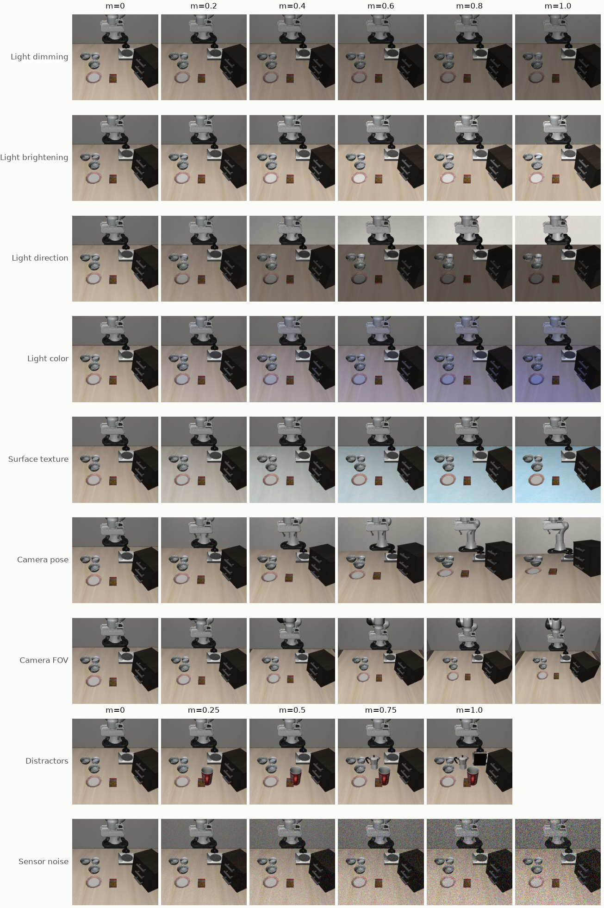
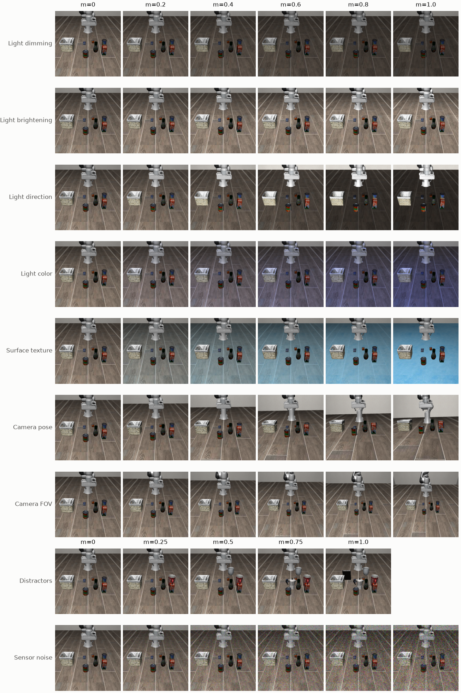
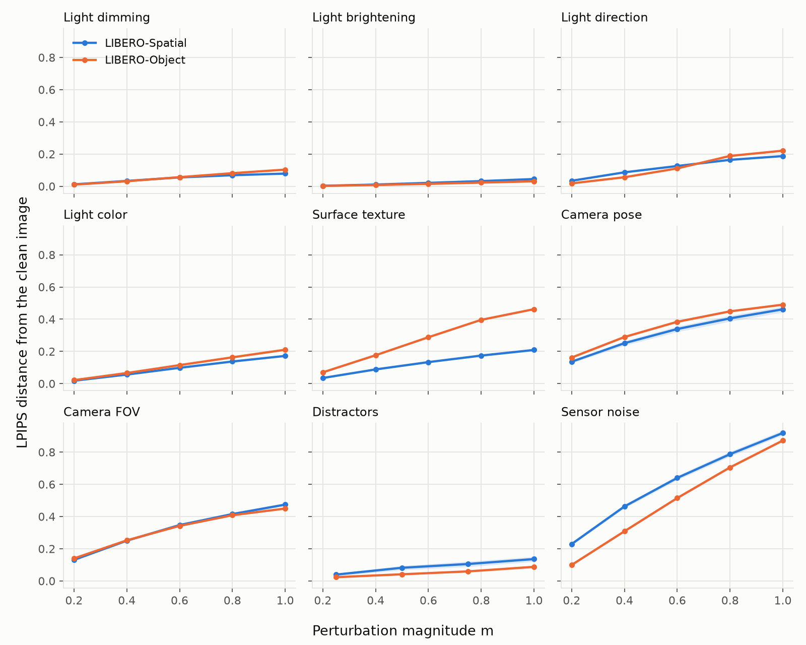

# Stage 1: A perturbation toolkit for LIBERO

**Outcome: go.** Nine continuous visual perturbations render the same MuJoCo state clean and perturbed. All 96 unit tests pass and every axis gives a monotone image-change curve on both suites.







## Toolkit

```python
from faultline_vla.envs.paired import make_scene, render_pair

scene = make_scene("libero_spatial", task_id=0)
pair = render_pair(scene, state, axis="camera_pose", m=0.6, seed=0, key=0)
pair["clean"], pair["perturbed"], pair["wrist"]
```

`m = 0` is always the clean scene, and the result is deterministic given `(axis, m, seed, key)`. Only the agentview camera changes.

| Axis | Change at `m = 1` |
|---|---|
| `light_dim` | Light intensity to 0.2× |
| `light_bright` | Light intensity to 2× |
| `light_direction` | Light rotated 90° |
| `light_color` | Diffuse light fully tinted |
| `texture` | Table or floor fully replaced by one of LIBERO's 35 textures |
| `camera_pose` | Camera orbits 20° around the point it looks at |
| `camera_fov` | Field of view ±15° |
| `distractors` | 4 held-out objects placed in clear space |
| `sensor_noise` | Gaussian noise, σ = 0.15 |

Distractors are static visual bodies with no joints or collisions. They are in every model, including clean, parked below the floor. This keeps the simulator state vector identical, so pairing is exact.

## Image change at maximum magnitude

Mean over 30 demo states per suite (3 from each of 10 tasks):

| Axis | LPIPS, Spatial | LPIPS, Object |
|---|---|---|
| Sensor noise | 0.92 | 0.87 |
| Camera FOV | 0.47 | 0.45 |
| Camera pose | 0.46 | 0.49 |
| Surface texture | 0.21 | 0.46 |
| Light direction | 0.19 | 0.22 |
| Light color | 0.17 | 0.21 |
| Distractors | 0.14 | 0.09 |
| Light dimming | 0.08 | 0.10 |
| Light brightening | 0.05 | 0.03 |

Spatial and Object differ most on surface texture. Spatial scenes retexture the table, and Object scenes, which have no table, retexture the floor.

LIBERO-Spatial results on this page were regenerated on 2026-11-10 after a bug in the distractor code misplaced the cabinet and stove in those scenes. LIBERO-Object images were pixel-identical before and after the fix.

## What this shows and what it doesn't

This shows that the perturbations are controllable, reproducible and leave physics untouched: tests confirm magnitude 0 is pixel-identical to clean, the same seed reproduces the same image, the scene restores exactly, the simulator state doesn't change, and the wrist camera stays unperturbed. Curves are monotone in LPIPS. It doesn't show that magnitudes are comparable across axes, since `m = 1` is a range choice for each axis, which is why Stage 2 normalizes by image change. Distractors aren't physical, so the robot could pass through one in closed loop. Only one texture and one light tint are sampled per state, so texture and tint effects are averaged across states rather than measured individually.
