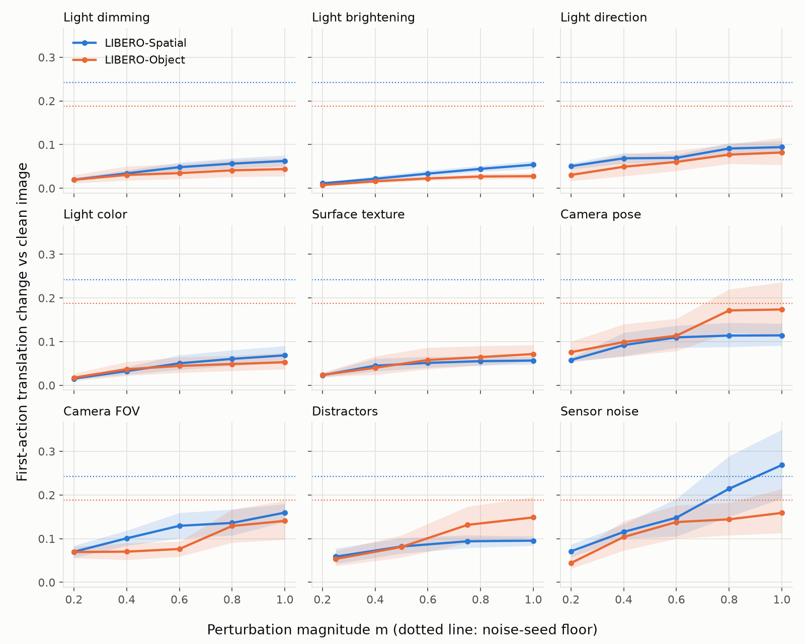
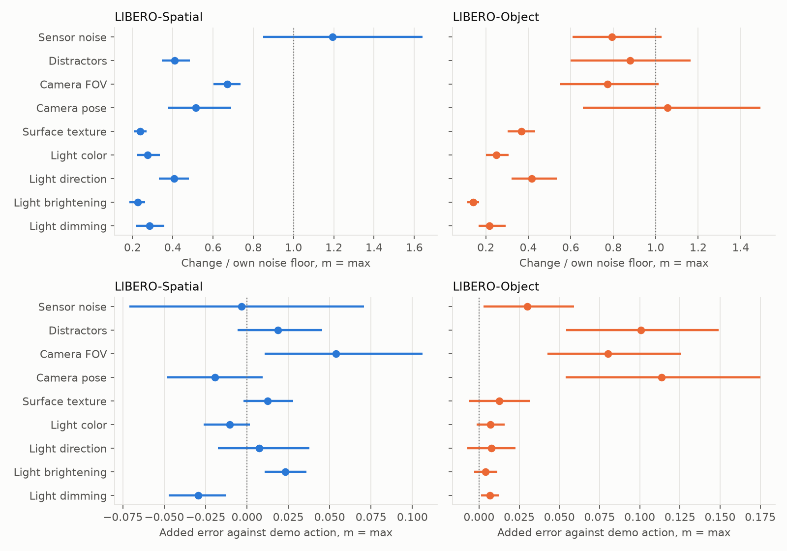
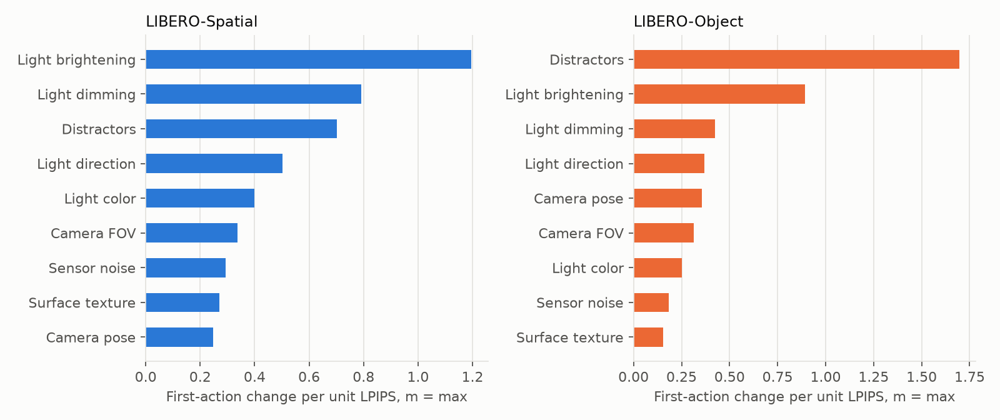
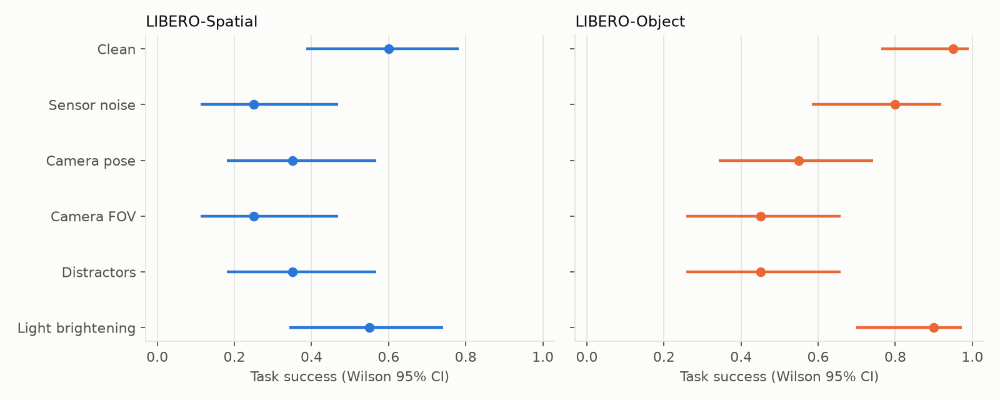

# Stage 2: Open-loop action sensitivity and closed-loop screen

**Outcome: the open-loop gate is a no-go, but the closed-loop screen found real failures.** Changing the image at full strength doesn't move SmolVLA's next action detectably more than redrawing the flow-matching noise does, on 18 of 18 axis-suite pairs under the pre-set test. Task success still falls sharply under some of the same perturbations. Distractors lower success on both suites, and camera pose and field of view lower it on LIBERO-Object.

The open-loop pilot uses 40 states per suite (2 demo and 2 rollout states from each of 10 tasks) across 44 perturbation conditions. The plan's full dataset was 500 states per suite. The closed-loop screen is 240 episodes.

## Open-loop method

Each state is rendered clean and perturbed, and SmolVLA predicts a 50-step action chunk from each with identical flow-matching noise. Only the agentview camera is perturbed. The wrist camera, proprioception and language are unchanged.

The main metric is the L2 change in the first action's translation, in normalized action units, against the clean-image action. The noise floor is the same distance between the clean-image action under the base noise seed and under three other seeds. Intervals are 95% bootstrap CIs over the 10 tasks.

An axis passes the gate when the lower CI of its change at maximum magnitude exceeds the upper CI of the floor. The gate needed at least 3 axes to pass.

## Gate result

| Axis | Spatial change at m = 1 [95% CI] | Object change at m = 1 [95% CI] |
|---|---|---|
| Sensor noise | 0.269 [0.192, 0.350] | 0.159 [0.113, 0.214] |
| Camera FOV | 0.160 [0.138, 0.180] | 0.141 [0.098, 0.187] |
| Camera pose | 0.114 [0.091, 0.141] | 0.174 [0.114, 0.236] |
| Distractors | 0.095 [0.084, 0.105] | 0.149 [0.102, 0.195] |
| Light direction | 0.094 [0.080, 0.108] | 0.082 [0.054, 0.116] |
| Light color | 0.069 [0.052, 0.090] | 0.053 [0.037, 0.075] |
| Light dimming | 0.063 [0.051, 0.076] | 0.044 [0.028, 0.069] |
| Surface texture | 0.057 [0.048, 0.065] | 0.072 [0.054, 0.092] |
| Light brightening | 0.054 [0.045, 0.063] | 0.028 [0.021, 0.035] |
| **Noise floor** | **0.242 [0.209, 0.288]** | **0.188 [0.174, 0.202]** |

No axis clears the gate on either suite. A looser test, mean change above the floor's mean, is met by one pair only: sensor noise on Spatial, at 0.269 against 0.242. That is still short of the 3 axes the gate required.

## Follow-up analyses (post-hoc)

These were chosen after seeing the gate result, so they describe the data and do not reverse the gate. The 18 axis-suite intervals below are not corrected for multiple comparisons.

- **Relative to each state's own floor,** the four strongest axes are sensor noise, camera pose, camera FOV and distractors. On Object, their mean ratios are 0.77 to 1.06, and all four intervals include 1. On Spatial, only sensor noise reaches 1 within its interval (1.19 [0.85, 1.64]). In 40% of Spatial states the sensor-noise change exceeds that state's floor.
- **Against the demonstrated action,** Object is hurt by geometry and clutter. Error against the demo rises by 0.114 [0.054, 0.175] for camera pose, 0.101 [0.054, 0.149] for distractors and 0.080 [0.043, 0.126] for FOV. Sensor noise gives a smaller rise, 0.030 [0.003, 0.059]. On Spatial, only FOV shows a comparable rise, 0.054 [0.011, 0.106].
- **Photometric axes are small on both suites.** Light and texture changes stay at 0.14 to 0.42 of the floor. The largest added error against the demo is 0.023 [0.011, 0.036], for light brightening on Spatial. Light dimming on Object also excludes 0 at 0.007, and light dimming on Spatial lowers error by 0.030. Three such intervals are unremarkable in a set of 18 uncorrected tests.
- **Gripper decisions are mostly stable.** The first-action gripper sign flips in at most 7.5% of states at maximum magnitude on any axis.

Per unit of LPIPS, distractors and light brightening rank highest because they change LPIPS very little (0.03 to 0.14), and sensor noise ranks near the bottom because it changes LPIPS a great deal (0.87 to 0.92). This ratio is unstable when the denominator is small, so the raw curves are the safer reading.

Mean change at maximum magnitude over all axes is largest in transport on Spatial (0.151) and in grasp and transport on Object (0.110 each). Demo and rollout states give similar results on Object (0.100 each) and on Spatial (0.104 and 0.112). Phase groups contain only 6 to 8 tasks each, so these are descriptive only.

## Closed-loop screen

A small open-loop change can still compound over an episode (Ross, Gordon and Bagnell, 2011), so the next step tests task success directly. The screen covers 5 conditions at m = 1 plus clean, on 2 suites × 10 tasks × 2 initial states, 240 episodes in all. Sensor noise, camera pose, FOV and distractors are the four strongest open-loop axes. Light brightening is the negative control, chosen for the smallest open-loop effect.

The policy replans every 10 steps, for at most 280 steps. Each perturbation is drawn once per episode after the scene settles and held fixed. Clean and perturbed episodes for the same task share initial state and flow-matching noise seed, so the comparison is paired.

The rule was fixed before any data: an axis counts as a closed-loop failure in a suite when the 95% task-bootstrap interval of the paired success drop excludes 0.

| Condition | Spatial success [Wilson 95% CI] | Spatial drop [95% CI] | Object success [Wilson 95% CI] | Object drop [95% CI] |
|---|---|---|---|---|
| Clean | 12/20, 0.60 [0.39, 0.78] | | 19/20, 0.95 [0.76, 0.99] | |
| Sensor noise | 5/20, 0.25 [0.11, 0.47] | **0.35 [0.05, 0.65]** | 16/20, 0.80 [0.58, 0.92] | 0.15 [-0.05, 0.35] |
| Camera pose | 7/20, 0.35 [0.18, 0.57] | 0.25 [-0.05, 0.55] | 11/20, 0.55 [0.34, 0.74] | **0.40 [0.15, 0.70]** |
| Camera FOV | 5/20, 0.25 [0.11, 0.47] | 0.35 [0.00, 0.70] | 9/20, 0.45 [0.26, 0.66] | **0.50 [0.20, 0.80]** |
| Distractors | 7/20, 0.35 [0.18, 0.57] | **0.25 [0.10, 0.40]** | 9/20, 0.45 [0.26, 0.66] | **0.50 [0.35, 0.65]** |
| Light brightening | 11/20, 0.55 [0.34, 0.74] | 0.05 [-0.15, 0.25] | 18/20, 0.90 [0.70, 0.97] | 0.05 [0.00, 0.15] |

Bold marks a pair that meets the rule.

| Axis | Verdict for "causes closed-loop failure" |
|---|---|
| Distractors | Confirmed on this screen (both suites) |
| Camera pose | Suggestive (Object only) |
| Camera FOV | Suggestive (Object only; the Spatial interval touches 0) |
| Sensor noise | Suggestive (Spatial only) |
| Light brightening | No detectable drop on either suite |

As a stricter check, Bonferroni-adjusted intervals for the 10 tests (99.5%) still exclude 0 for Object distractors, FOV and pose and for Spatial distractors. They do not exclude 0 for Spatial sensor noise. This check was added after the rule was set.

Open-loop size does not predict the closed-loop drop on its own. Spatial sensor noise is the largest open-loop effect and has a large drop, but Spatial distractors have a ratio of only 0.41 and still fail, and Object sensor noise has a ratio of 0.79 and does not meet the rule. The three Object axes with the largest rises in error against the demo are the same three that failed in closed loop.

## What this shows / what it doesn't

**Shows.** For this checkpoint, single-step actions respond no more detectably to visual change than to sampling noise, yet task success drops by up to half under distractors, camera pose and field of view. Lighting at this strength (brightening) produced no detectable drop. An open-loop gate on first-action change would have missed failures that the closed-loop test finds.

**Doesn't show.** These results come from one chosen maximum magnitude per axis and 20 paired episodes per cell, with two per task, so intervals are wide and clean Spatial success is itself only 12/20. Spatial tasks 3, 5 and 9 failed both clean episodes, which limits how large a drop they can show. A task bootstrap with 10 tasks is coarse. Fixture placement is held at one layout per task, so variation between episodes comes from object and robot initial states. Distractors don't collide, so the robot can pass through them, and they can hide the target. Only agentview is perturbed. The screen ran only the five axes above, so the others remain untested in closed loop. It also says nothing yet about where in the network the failures arise, which is Stage 3.

LIBERO-Spatial results on this page were regenerated on 2026-11-10 after a bug in the distractor code misplaced the cabinet and stove in those scenes. LIBERO-Object results were not affected, as stored images were pixel-identical after the fix.
