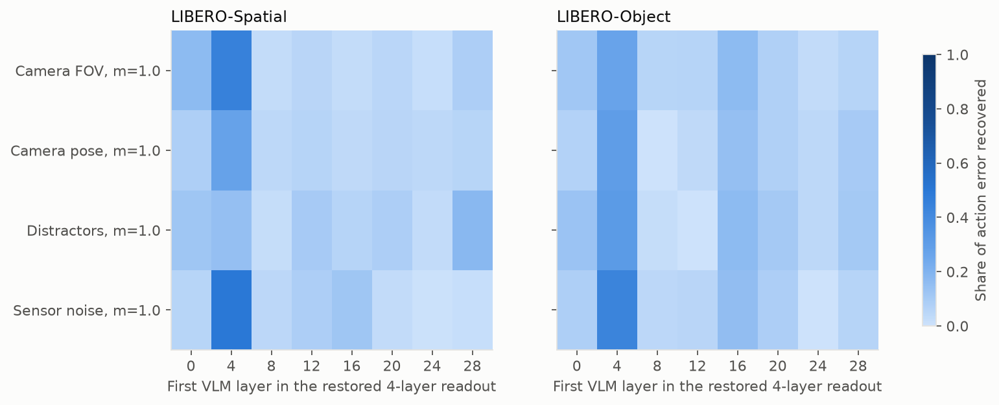
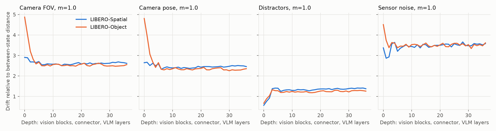
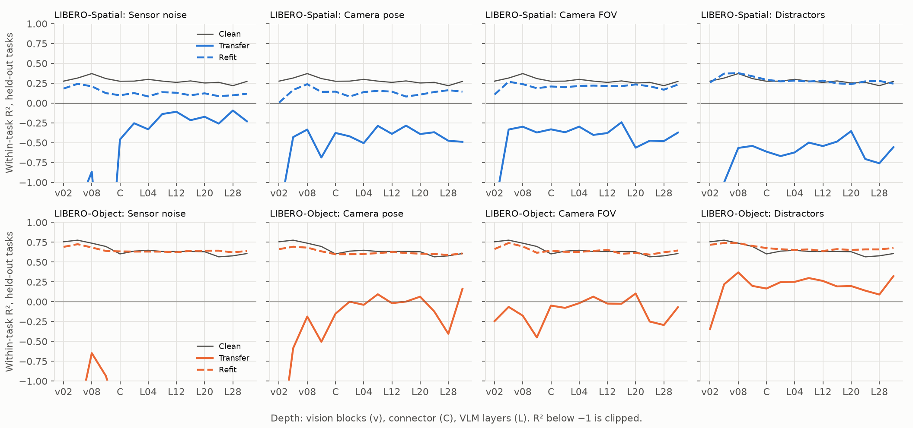

# Stage 3: Where the failing perturbations act inside SmolVLA

**Outcome: diffuse on every axis tested.** No window of up to 16 of the 32 VLM layers recovers 80% of the action error, for any of the four perturbations that caused closed-loop failures, on either suite. By the plan's go/no-go, no axis has a localized break, so the targeted-fix stage has no single site to target.

Two patterns hold on all eight axis-suite cases. The perturbation's representational change is set in the vision encoder and carried unchanged through all 32 VLM layers. And among the expert's readouts, VLM layers 4–7 carry the largest single share of the action error.

## Method

The axes are the four that met the closed-loop failure rule in Stage 2 in at least one suite: sensor noise, camera pose, camera FOV and distractors, all at m = 1. Both suites were run for every axis so that a suite where an axis passed can be compared with one where it didn't. Each suite has 40 states (2 demo and 2 rollout states from each of 10 tasks) from the Stage 2 dataset, with 2 flow-matching noise seeds, giving 640 patched cases. The run took 4.9 hours on CPU.

**Readout patching.** SmolVLA runs its VLM once over the image, language and state prefix and caches each layer's keys and values. The action expert reads that cache at every layer during all 10 denoising steps. Patching swaps cached layers between the clean and perturbed prefills, with identical noise, so it changes only what the expert reads. This follows path-patching practice (Goldowsky-Dill et al., 2023; Zhang and Nanda, 2023). The 32 layers are grouped into 8 bins of 4.

- **Restore:** start from the perturbed cache and put clean readouts into a window of 1 to 4 bins (4 to 16 layers). Recovery is the share of the perturbed-vs-clean action error that disappears.
- **Induce:** start from the clean cache and put perturbed readouts into one bin. The induced share is the error this produces as a share of the full perturbation's error.
- **Agentview only:** like restore, but swap only the 64 agentview image-token positions.

Action error is the mean L2 distance over the 50-step chunk on the 6 arm dimensions. Recovery pools error over states, and intervals are 95% bootstrap CIs over the 10 tasks.

**Drift.** Cosine distance between clean and perturbed activations for agentview tokens, at vision-encoder blocks 2, 5, 8 and 11, the connector output and each VLM layer's cached values. It is divided by the distance between two different clean states of the same task, so 1 means the perturbation moves the representation as far as a change of state does. Linear CKA (Kornblith et al., 2019) is also reported.

**Rules fixed before the run.** A break window is the smallest contiguous window that recovers at least 80%. If no window of at most half the layers reaches 80%, the axis is diffuse. For an axis with a window, a drift gain above 1.25 from the connector to the last VLM layer calls it a backbone break, otherwise an encoder break.

## Results

| Suite | Axis | Best single bin | Best 16-layer window | Drift gain | Call |
|---|---|---|---|---|---|
| Spatial | Sensor noise | 0.50 [0.44, 0.56] | 0.68 [0.62, 0.73] | 0.98 | diffuse |
| Spatial | Camera FOV | 0.45 [0.37, 0.53] | 0.66 [0.60, 0.72] | 0.99 | diffuse |
| Spatial | Camera pose | 0.28 [0.16, 0.39] | 0.50 [0.41, 0.56] | 0.98 | diffuse |
| Spatial | Distractors | 0.18 [0.11, 0.23] | 0.41 [0.35, 0.48] | 0.98 | diffuse |
| Object | Sensor noise | 0.43 [0.36, 0.51] | 0.65 [0.60, 0.70] | 1.00 | diffuse |
| Object | Camera FOV | 0.27 [0.21, 0.32] | 0.49 [0.44, 0.54] | 0.99 | diffuse |
| Object | Camera pose | 0.30 [0.24, 0.37] | 0.45 [0.39, 0.50] | 0.97 | diffuse |
| Object | Distractors | 0.31 [0.25, 0.40] | 0.49 [0.41, 0.58] | 0.98 | diffuse |

Every best window starts at layer 0 or layer 4. Even the best half of the network's readouts leaves a third to over half of the error in place.

**Layers 4–7 matter most.** Restoring this bin recovers more than any other single bin in 7 of 8 cases, and its interval lies above the next-best bin's in 6 of them. Spatial distractors is the exception, where layers 28–31 recover slightly more (0.18 against 0.14). Inducing the perturbation in layers 4–7 alone reproduces 41% to 60% of the full error, the largest of any bin in all 8 cases. The pattern is the same for both noise seeds.

**The effect is spread, not additive.** Single-bin recoveries sum to only 0.65–0.90, while single-bin induced shares sum to 1.6–2.1. Each bin's perturbed readout can cause much of the error alone, but undoing it needs many bins at once. This is what readout redundancy looks like: the perturbation is present in every layer the expert reads.

**Only the image tokens matter.** Restoring only the agentview token positions gives the same recovery as restoring every token, to within 0.04 in every bin. The perturbation reaches the expert through the image tokens' own keys and values, not through the language or state tokens.

**Sanity check at the connector.** Replacing only the agentview connector output with its clean value, and rerunning the whole VLM, reproduces the clean action exactly: the remaining error is 0 in all 320 cases (40 states × 8 axis-suite cases, noise seed 0). The image enters the model only through the connector, so this confirms the patching wiring, not a finding. It also confirms that a fix at the connector output could in principle remove all of the single-step error, unlike a fix in any one window of readouts.

**Drift is set in the vision encoder and then held constant.** From the connector output to the last VLM layer, normalized drift barely changes: the gain is 0.97 to 1.00 in all 8 cases, against the 1.25 threshold for a backbone break. Inside the encoder, the axes differ:

- **Camera pose and FOV** move early encoder features about 5 times as far as a change of state on Object (about 2.7 times on Spatial). This falls to about 2.5 by the connector and stays there.
- **Sensor noise** gives the largest drift that persists: about 3.5 times a change of state, through every VLM layer.
- **Distractors** start below 1 and grow through the encoder to about 1.3, which fits a small, local change in the image that the encoder spreads more widely.

## Weaker perturbations (partial check)

The same analysis was started at m = 0.6 for sensor noise, camera pose and FOV, and at 0.5 (2 of 4 objects) for distractors, the nearest rendered step. Shards took more than 2 hours each, so the run was stopped with 5 of the 20 tasks done, all on LIBERO-Object (tasks 0–3 and 6: 20 states, 2 noise seeds). It is a partial check, not a full result.

| Axis (Object) | Best single bin | Best 16-layer window | Drift gain | Call |
|---|---|---|---|---|
| Sensor noise, 0.6 | 0.38 [0.28, 0.51] | 0.56 [0.46, 0.61] | 0.99 | diffuse |
| Camera FOV, 0.6 | 0.12 [0.02, 0.19] | 0.40 [0.32, 0.46] | 0.98 | diffuse |
| Camera pose, 0.6 | 0.21 [0.15, 0.25] | 0.39 [0.29, 0.45] | 0.98 | diffuse |
| Distractors, 0.5 | 0.28 [0.21, 0.36] | 0.46 [0.39, 0.53] | 0.98 | diffuse |

All four stay diffuse, with best windows below the m = 1 values. Layers 4–7 are again the best single bin in all four, though for camera FOV the margin over layers 20–23 (0.11) is within noise. Drift is again flat from the connector on. Figures: [heatmap](../results/figs/stage3_break_heatmap_m06.png), [drift](../results/figs/stage3_drift_m06.png).

## Is the target's position destroyed or moved? (probes)

Linear probes ask whether the perturbed features still contain where the target object is. Ridge regression (standardized, regularization chosen by cross-validation) reads the target object's world position from agentview features pooled to a 4×4 grid, at vision blocks 2, 5, 8 and 11, the connector and every fourth VLM layer. Each suite has 300 demo states (30 per task), and whole tasks are held out in 5 folds. Three modes are compared (Hewitt and Liang, 2019):

- **Clean:** train and test on clean features.
- **Transfer:** train on clean features, test on perturbed ones. High transfer means the information is still there in the same form.
- **Refit:** train and test on perturbed features. High refit with low transfer means the information is still there but encoded differently, so it has moved, not been destroyed.

**The planned analysis can't answer the question.** On clean features its held-out-task R² is only about 0.27 on Object and below 0 on Spatial. With states from the same tasks in training, the same features reach about 0.9 on Object, so the information is there. The gap comes from layout: up to 58% of the variance in target position lies between tasks, and a probe can't predict an unseen task's layout from 9 others. Its figure is kept as [stage3_probes_target_pos.png](../results/figs/stage3_probes_target_pos.png). It also shows perturbed refit scoring above clean, which this analysis did not resolve.

**Within-task analysis (added after the planned one).** Each task's mean is subtracted from the labels and the features, so the probe only has to follow how the target moves within a task. Tasks are still held out. For transfer, perturbed features are centered with the clean task means, so the probe gets no help from perturbed statistics.

| Suite | Axis | Clean | Transfer | Refit |
|---|---|---|---|---|
| Object | Sensor noise | 0.60 [0.35, 0.72] | −1.52 [−2.32, −0.98] | 0.63 [0.50, 0.70] |
| Object | Camera pose | 0.60 [0.35, 0.72] | −0.15 [−0.61, 0.12] | 0.60 [0.48, 0.66] |
| Object | Camera FOV | 0.60 [0.35, 0.72] | −0.05 [−0.41, 0.18] | 0.64 [0.46, 0.73] |
| Object | Distractors | 0.60 [0.35, 0.72] | 0.17 [−0.26, 0.39] | 0.68 [0.53, 0.75] |
| Spatial | all four | 0.27 [−0.19, 0.40] | −0.61 to −0.33 | 0.10 to 0.29 |

Within-task R² for target position at the connector output, with 95% task-bootstrap intervals. Other depths look the same (figure). The gripper-to-target vector gives the same pattern at lower values.

- **Object: moved, not destroyed.** For every axis and at every depth from vision block 5 on, refit matches clean. A probe trained on clean features fails on perturbed ones, with transfer at or below 0 for all four axes. The position of the target is still linearly readable after the perturbation, but in a different direction of feature space. This is the same for camera changes, sensor noise and distractors, so it isn't specific to camera pose.
- **Spatial: inconclusive.** Even the clean probe's interval includes 0, so there is no baseline to compare against. Spatial's target is the same black bowl in different layouts, and 30 states per task are too few to track it.
- **Pixel baseline: uninformative.** Raw 16×16 pixels give large negative R² in both analyses, so they don't serve as the planned lower bound.

## Hypotheses

| Hypothesis | Verdict | Evidence |
|---|---|---|
| H1: the frozen encoder absorbs photometric shifts | Refuted for sensor noise; lighting and texture not tested | Sensor noise has the largest persistent drift on both suites. Lighting and texture didn't cause closed-loop failures, so they weren't run here. |
| H2: camera pose keeps world-frame information while action error appears late | Refuted for "error appears late" (both suites). "Keeps information" is suggestive, Object only. | Camera pose has no late window: its best windows start at layer 0 or 4. Within-task probes on Object show the target's position survives at every depth but moves to a different encoding (refit ≈ clean, transfer ≤ 0). Spatial probes are too weak to judge, and the same holds for the other three axes, so it isn't camera-specific. |
| H3: distractors break mid-backbone | Refuted on both suites (readout and drift parts) | No middle-layer window: the best windows start at layers 0 or 4 and no window reaches 80%. Drift does not grow inside the VLM. The target-object token part wasn't tested. |

## What this shows / what it doesn't

**Shows.** For these four perturbations, SmolVLA's failure does not sit in one stretch of the VLM. The visual change is formed in the frozen vision encoder, passed through the frozen VLM almost unchanged, and read by the action expert from every layer. Layers 4–7 carry the largest single share, but no window of up to half the layers recovers 80%. A fix placed in one window of readouts would be capped well below full recovery. A fix at or before the connector would not face that cap, because every downstream readout comes from it, and the connector check shows that restoring it removes all of the error. On LIBERO-Object, the probes suggest the perturbations don't erase where the target is. They re-encode it in a form that a readout trained on clean images doesn't follow. That fits a failure of the frozen downstream readout to generalize, not a loss of information.

**Doesn't show.** The 80% threshold, bin size and window limit were set before the run without a pilot, and a different threshold would change the call, though not the measured curves. Recovery is measured on single-step action chunks, which Stage 2 showed are a weak guide to closed-loop failure. The sample is 40 states per suite with 2 noise seeds. The weaker-strength check covers only 5 Object tasks, so it can't speak for Spatial. Drift is normalized by distance to one other state of the same task, a scale choice. The probes' planned analysis was uninformative, and the within-task analysis that replaced it was chosen after seeing the results. Probes have no random-initialization or control-task baselines, and decodable information is not necessarily used by the policy (Belinkov, 2022). The probe results on Spatial are inconclusive. Target-object token groups were not run, so part of H3 stays open.